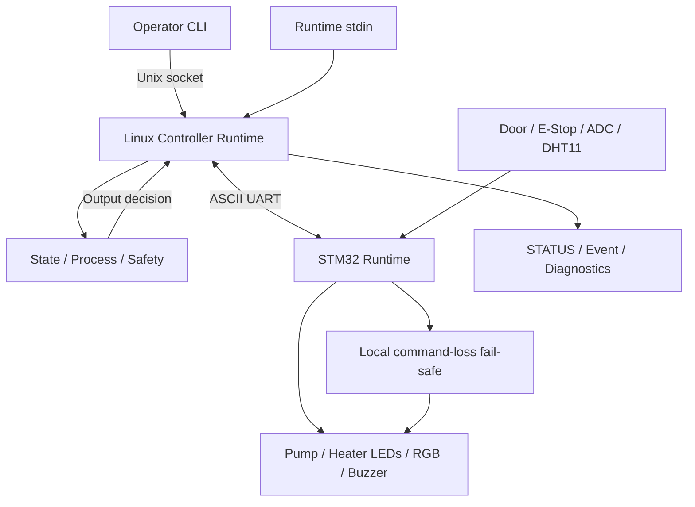

<p align="center">
  
</p>

<p align="center">
  
  
  
  
  
</p>

<p align="center">
  <a href="#development-process">Development Process</a> ·
  <a href="#troubleshooting">Troubleshooting</a> ·
  <a href="#architecture">Architecture</a> ·
  <a href="#state--sequence">State / Sequence</a> ·
  <a href="#build">Build</a>
</p>

# Equipment Controller

**STM32에서 수집한 스위치·ADC·DHT11 데이터를 UART로 받아 공정 상태와 안전 조건을 판단하고, 장비 출력을 제어하는 Controller입니다.**

Linux / WSL Runtime은 State Machine, 30초 Pump / Heater 공정, Alarm과 출력 상태를 관리합니다. STM32는 센서 입력과 GPIO를 담당하며 독립적인 command-loss fail-safe로 통신 상실 시 출력을 차단합니다. 별도 Operator CLI `./ctl`은 Unix Domain Socket으로 실행 중인 Runtime에 연결합니다.

Pump / Heater는 LED로 동작을 표시하고 RGB LED와 Buzzer로 장비 상태·경보를 확인합니다.

## Development History

| 날짜 | 개발 내용 |
|---|---|
| 2026.10.08 | Controller State / Sequence · Logging · ASCII Protocol · Serial Transport · STM32 GPIO / ADC / UART · 실제 Door / E-Stop E2E |
| 2026.10.12 | DHT11 Decoder / Production 연결 · STM32 command-loss fail-safe · Linux recovery · READY / Re-arm · Critical Safety |
| [2026.10.13](https://github.com/triton0305/equipment-controller/commit/bf68826a3fcef151fffd86913d0bd17d8614393d) | 6초 간격 30초 공정 · 온도 / 압력 시작 자격 · 통신 단절 RED 인계 · UART 진단 |
| [2026.10.13](https://github.com/triton0305/equipment-controller/commit/c5cbb81c065af3e47e83bf65d401320adfdbf856) | UART output coalescing · 독립 Operator CLI / Unix socket IPC · CTest 53/53 PASS · CLI 실물 확인 |

## Development Process

장비 운용 시나리오와 안전 정책을 정하고 ChatGPT와 State Machine, 공정·Interlock·통신 책임을 검토했습니다. 확정된 요구사항은 Codex를 활용해 구현하고 자동 회귀 테스트와 실제 NUCLEO-F411RE 운전으로 확인했습니다.

실제 실행에서 발견한 동작을 기준으로 30초 공정과 READY 조건, 통신 단절 표시와 CLI 명령의 운용 의미를 재검토했습니다. 요구·설계 검토·구현·실물 검증의 역할과 근거를 각각 기록했습니다.

[▶ Design Decisions & Collaboration](docs/design-decisions.md) — 주요 결정 8건과 사용자·ChatGPT·Codex 역할

## Troubleshooting

Communication-loss Fail-safe, DHT11 Decimal Decoder, 간헐 UART Telemetry Gap, 반복 Output Refresh / Write Stall, Linux Serial Disconnect / Reconnect의 5개 사례를 정리했습니다.

Raw frame·계측·Host regression·실제 보드 결과를 연결해 원인과 조치, 검증 범위를 기록했습니다. UART telemetry 공백은 발생 계층 미확정 상태로 관리합니다.

[▶ Troubleshooting](docs/troubleshooting.md) — 증상·원인 조사·조치·검증

## Validation

최신 소프트웨어 기준선 `c5cbb81`에서 **CTest 53/53 PASS**를 확인했습니다. 실제 NUCLEO-F411RE에서는 입력 → STM32 → UART → Linux 판단 → UART → GPIO 출력 경로와 독립 CLI 운전을 검증했습니다.

| 범위 | 결과 |
|---|---|
| Controller / Protocol / Transport / Firmware Host regression | 53/53 PASS |
| UART diagnostics / output coalescing / CLI / IPC | HOST VERIFIED |
| Board · GPIO · Door / E-Stop · Pressure ADC · 양방향 UART | HW VERIFIED |
| DHT11 Decoder / Production UART / Linux 실제값 | HW VERIFIED |
| 30초 Pump / Heater 순서·출력·정상 완료 | HW VERIFIED |
| Door / Pressure READY · 새 5초 qualification · Cycle Re-arm | HW VERIFIED |
| Temperature READY | HOST VERIFIED · 정상 범위 HW 관찰 |
| Door / E-Stop E2E · Pressure Critical · B1 RESET | HW VERIFIED |
| Communication-loss 물리 출력 차단 | HW VERIFIED |
| Communication-loss Local RED | HOST VERIFIED · 점등 시점 HW 확인 대기 |
| CLI 연결·HELP / STATUS·START / RESET·STOP 로컬 거부 | HW VERIFIED |

Pump / Heater는 LED 출력으로 확인했습니다. CLI snapshot은 Runtime이 보유한 값과 출력 결정입니다. IPC 상세 예외 처리는 Host 검증 범위로 기록합니다.

[▶ Verification Report](docs/verification.md) — 통합 검증 matrix와 후속 계측  
[▶ Hardware Verification](firmware/stm32-equipment-io/hardware-verification.md) — 날짜별 실물 근거

## Demo

### Emergency Stop (E-Stop)


[▶ E-Stop 원본 영상 보기 (YouTube)](https://youtu.be/wWkQ-iPONAk)

실물 E2E Harness의 RUN 상태에서 E-Stop을 누르면 Pump / Heater와 RUN 표시가 꺼지고 ERROR RED와 Buzzer가 작동합니다.

## Key Features

| 영역 | 구현 |
|---|---|
| Process | 5초 READY qualification · 6초 간격 30초 공정 · Door re-arm |
| Safety | Door / E-Stop · CommunicationFault · Critical Sensor Safety · Error latch / RESET |
| Sensor | Door · E-Stop · 12-bit Pressure ADC · DHT11 · validity / freshness |
| Interface | 독립 Operator CLI · Unix socket IPC · Runtime stdin |
| UART Runtime | ASCII framing · session 동기화 · 오류 / stale 감지 · 재연결 · batch output refresh |
| STM32 Runtime | GPIO · cooperative ADC / DHT11 · USART2 RX / TX · local timeout / latch |
| Observability | 1초 STATUS · 이벤트 로그 · UART flight recorder |
| Verification | PTY · HAL Fake · 실제 executable / CLI · NUCLEO 실물 검증 |

## Architecture



Runtime가 UART와 명령 guard를 소유하고 CLI는 입력·응답을 담당합니다. STM32는 실제 I/O를 적용하고 command refresh 상실을 독립적으로 감시합니다.

## State / Sequence

Core 상태는 Idle / Run / Error를 중심으로 운전합니다. READY는 Idle 상태에서 별도로 관리하는 시작 자격 표시입니다.

| 상황 | 상태 / 표시 |
|---|---|
| Idle / qualification 진행 | Idle · RGB Blue |
| 시작 조건 5초 완료 | Idle · Ready=1 · RGB Yellow |
| START 수락 | Run · RGB Green · 공정 시작 |
| 정상 30초 완료 | Idle · 출력 OFF · Door re-arm |
| Fault | Error · 안전 출력 · RED |
| 안전 조건에서 RESET | Idle · 새 READY qualification |

### READY / START

Idle · Armed, UART Operational / 정상 통신, fresh Door CLOSED / E-Stop OFF, 유효한 Temperature **20~40°C**와 Pressure ADC **1000~2000**을 **5초 연속** 유지해야 START가 허용됩니다.

조건 이탈이나 invalid / stale은 qualification을 취소합니다. 정상 복귀 후 새 5초가 필요하며 START 입력 순간에도 현재 조건을 재검사합니다. Humidity는 Critical Safety에 사용합니다.

### 30초 공정

| START 수락 후 | 동작 | Pump | Heater |
|---|---|---|---|
| 0초 | PROCESS START / RUN | OFF | OFF |
| 6초 | PUMP ON | ON | OFF |
| 12초 | HEATER ON | ON | ON |
| 18초 | HEATER OFF | ON | OFF |
| 24초 | PUMP OFF | OFF | OFF |
| 30초 | PROCESS COMPLETE / IDLE | OFF | OFF |

공정 시간은 `steady_clock` 경과시간으로 계산합니다. Sensor RX의 Safety 판단을 유지하며 Fault 발생 시 정상 공정 대신 안전 출력을 적용합니다.

정상 완료 후 Door OPEN → CLOSED와 새로운 시작 자격 확인을 거쳐 다음 사이클을 준비합니다.

[▶ Process Control](docs/process-control.md) — 시작 조건·시간 경계·Re-arm·RESET

## Interlock / Fault

| 원인 | 처리 |
|---|---|
| 물리 E-Stop | EmergencyStop · Error |
| RUN 중 Door OPEN | DoorOpen · Error |
| UART 장애 / sensor stream timeout | CommunicationFault · Error |
| Motor Fault | MotorFault · Error |
| Temperature ≤5°C / ≥50°C | 같은 방향 새 유효 측정 2회 → TemperatureCritical |
| Humidity ≤15% / ≥90% | 같은 방향 새 유효 측정 2회 → HumidityCritical |
| Pressure ADC ≤200 / ≥3900 | 같은 방향 새 유효 측정 2회 → PressureCritical |

Critical은 새 측정만 계산하고 정상값·invalid·stale·방향 변화로 streak을 초기화합니다. READY 범위와 운전 중 Critical 범위는 별도 정책입니다.

Error에서는 Pump / Heater / RUN OFF, Valve CLOSED를 결정하고 RED / Alarm latch를 유지합니다. Buzzer는 약 2초 후 OFF가 됩니다. 센서 정상 복귀나 통신 복구만으로 재시작하지 않습니다.

RESET은 Error, fresh Door CLOSED / E-Stop OFF, 정상 통신·Motor와 유효한 세 센서가 Critical 범위 안쪽인 조건을 요구합니다.

### Communication-loss Safety

STM32는 순서가 맞는 6-command complete refresh를 감시합니다. 정상 refresh 없이 1000 ms가 경과하면 local safe-state와 latch를 적용하고 늦게 도착한 ON을 차단합니다.

유효 세션의 command loss는 local RED로 표시하며 SAFE 재동기화와 Linux ERROR 표시 인계에서 RED를 보존합니다. 정확한 물리 응답시간과 최신 Local RED timing은 검증 보고서의 후속 계측 항목입니다.

[▶ UART Recovery](docs/uart-recovery.md) · [▶ STM32 Runtime](firmware/stm32-equipment-io/stm32-runtime.md)

## Hardware

| 구성 | 장비 / 역할 |
|---|---|
| MCU | NUCLEO-F411RE · STM32F411RET6 |
| Debug / UART | ST-LINK/V2.1 Virtual COM Port |
| Host | Linux / WSL · usbipd passthrough |
| 입력 | Door / E-Stop · B10K 가변저항 · DHT11 · B1 USER |
| 출력 | Pump / Heater LED · RGB LED · Buzzer |
| 통신 | USART2 · 115200 baud · 8N1 |

<details>
<summary>Pin / Clock</summary>

| 신호 | Pin / 동작 |
|---|---|
| Pressure ADC | PA0 / ADC1_IN0 · raw 0~4095 |
| USART2 TX / RX | PA2 / PA3 |
| Door | PB0 · LOW=CLOSED |
| E-Stop | PB1 · LOW=ON |
| B1 RESET | PC13 |
| Pump / Heater | PB7 / PA6 · HIGH=ON |
| Buzzer | PA7 |
| RGB R / G / B | PB4 / PB5 / PB6 |
| DHT11 DATA | PC4 |

HSI 16 MHz → PLL · SYSCLK / HCLK 84 MHz · APB1 42 MHz · APB2 84 MHz. TIM5는 84 MHz timer clock / prescaler 83으로 1 MHz tick을 사용합니다.

</details>

## Build

### Linux Controller / CLI

C++17 / C compiler, CMake 3.16 이상, Python 3와 Linux termios / PTY 환경이 필요합니다.

```bash
cmake -S . -B build -DCMAKE_BUILD_TYPE=Debug
cmake --build build -j2
ctest --test-dir build --output-on-failure
```

### Runtime / Operator Console

Terminal 1:

```bash
./run
# 다른 UART 경로: ./run /dev/ttyACM1
```

Terminal 2:

```bash
./ctl
```

```text
ctl> status
ctl> start
ctl> reset
ctl> help
ctl> exit
```

CLI 지원 명령은 `start reset status help exit`입니다. `help` / `exit`은 CLI 로컬에서 처리하며 종료 후 Runtime은 계속 실행됩니다. START / RESET은 기존 안전 guard를 사용합니다.

[▶ CLI Guide](docs/cli.md) — 응답·snapshot·socket·lifecycle

### STM32 Build

CMake 3.22 이상, Ninja와 Arm GNU Toolchain을 사용합니다.

```bash
cd firmware/stm32-equipment-io
cmake --preset Debug -DDHT11_HARDWARE_TEST=OFF -DSTEPPER_HARDWARE_TEST=OFF
cmake --build --preset Debug
```

Production ELF는 `firmware/stm32-equipment-io/build/Debug/stm32-equipment-io.elf`입니다. SWD Flash는 ST-LINK를 사용합니다. WSL 연결 후 `lsusb`와 `/dev/ttyACM0`을 확인하고 USB 재연결 시 attach 상태를 확인합니다.

## ASCII Protocol

모든 메시지는 LF 기반 `KEY:VALUE\n`입니다.

| 방향 | 메시지 |
|---|---|
| STM32 → Linux | DOOR:CLOSED/OPEN · ESTOP:ON/OFF |
| STM32 → Linux | PRESSURE:정수/INVALID · TEMP:숫자/INVALID · HUMIDITY:숫자/INVALID |
| Linux → STM32 | PUMP:ON/OFF · HEATER:ON/OFF · VALVE:OPEN/CLOSED |
| Linux → STM32 | BUZZER:ON/OFF · RUN_LED:ON/OFF · ERROR_LED:ON/OFF |
| Linux → STM32 | STATE:SAFE/IDLE/READY/RUN/ERROR |

표의 slash는 선택 가능한 값을 나타냅니다. Complete refresh 순서는 PUMP → HEATER → VALVE → BUZZER → RUN_LED → ERROR_LED이며 STATE는 뒤의 별도 명령입니다.

온습도는 새 측정 결과를 전송하고 센서별 validity / freshness를 유지합니다. [DHT11 Integration](docs/dht11-integration.md)에 측정·실패·UART queue 정책을 기록합니다.

## Project Structure

| 경로 | 책임 |
|---|---|
| `apps/controller/` | Runtime · 독립 CLI · IPC |
| `modules/core/` | State / Sequence / Safety / Alarm |
| `modules/protocol/` | ASCII parsing / serialization |
| `modules/transport/` | SerialTransport / UART recorder |
| `modules/logging/` | Console / File Logger |
| `firmware/stm32-equipment-io/` | CubeMX · STM32 Device I/O / Runtime |
| `tests/` | Core / PTY / Fake-HAL / CLI regression |
| `docs/` | 사용법 · 정책 · 설계 · 검증 · 장애 조사 |

## Documentation

| 문서 | 내용 |
|---|---|
| [CLI](docs/cli.md) | Operator Console 사용법 |
| [Controller Runtime](docs/controller-runtime.md) | 명령·freshness·출력·lifecycle |
| [Process Control](docs/process-control.md) | READY·30초 공정·Re-arm·Critical·RESET |
| [UART Recovery](docs/uart-recovery.md) | session·timeout·안전 재연결 |
| [UART Diagnostics](docs/uart-diagnostics.md) | recorder 사용법·계측 해석 |
| [DHT11 Integration](docs/dht11-integration.md) | 센서부터 Runtime까지의 운영 경로 |
| [Design Decisions](docs/design-decisions.md) | 주요 정책 결정과 역할 기록 |
| [Troubleshooting](docs/troubleshooting.md) | 공개 장애 사례 5건 |
| [Verification Report](docs/verification.md) | 통합 Host / HW 결과·후속 항목 |
| [STM32 Runtime](firmware/stm32-equipment-io/stm32-runtime.md) | MCU I/O·protocol·local fail-safe |
| [Hardware Verification](firmware/stm32-equipment-io/hardware-verification.md) | 날짜별 실물 검증 근거 |

현재 후속 계측은 UART telemetry 공백의 발생 구간, 장시간 통신 안정성, Local RED timing과 Temperature READY 범위 이탈 시험입니다.
