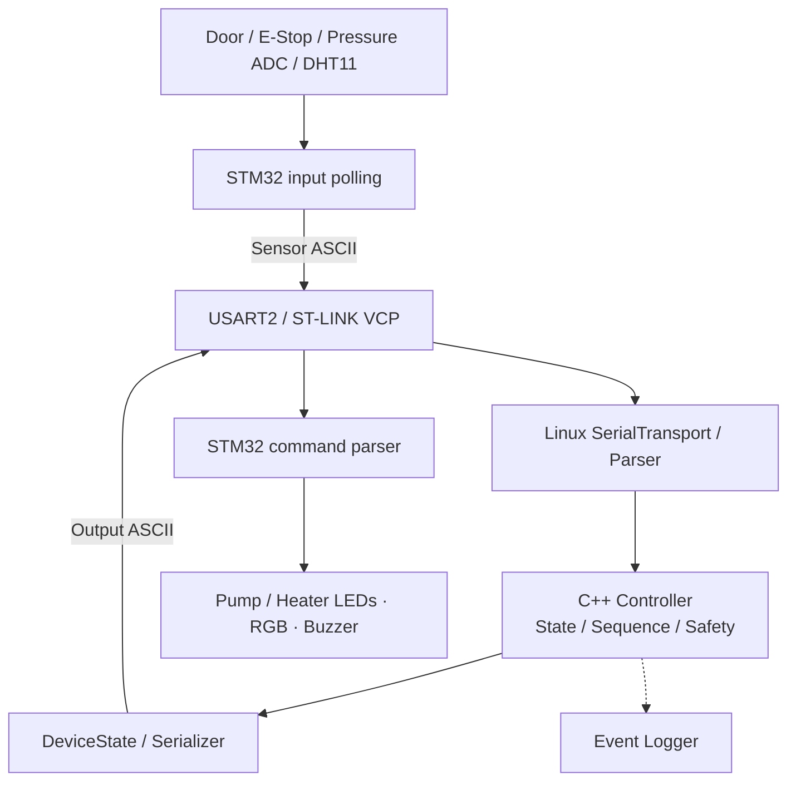
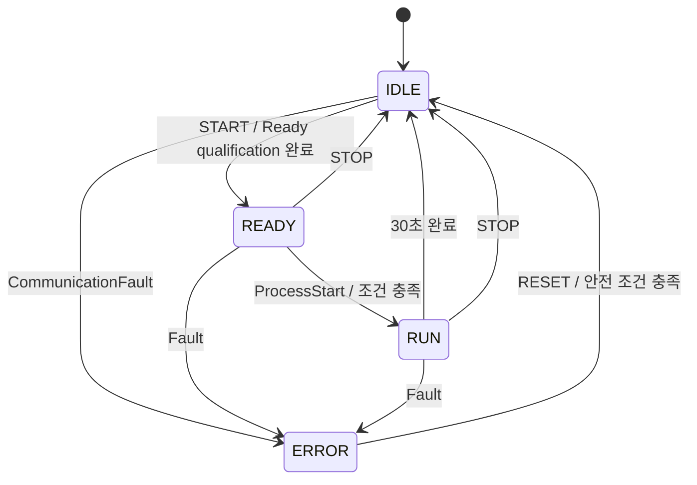

<p align="center">
  
</p>

<p align="center">
  
  
  
  
  
</p>

<p align="center">
  <a href="#development-process">Development Process</a> ·
  <a href="#troubleshooting">Troubleshooting</a> ·
  <a href="#architecture">Architecture</a> ·
  <a href="#state--sequence">State / Sequence</a> ·
  <a href="#build">Build</a>
</p>

# Equipment Controller

**STM32에서 수집한 스위치·ADC·DHT11 센서 데이터를 UART로 받아 공정 상태와 인터록을 판단하고, 장비 출력을 제어하는 C++17 Controller입니다.**

Linux / WSL에서 State Machine, Sequence, Alarm과 출력 상태를 관리합니다. STM32는 Door·E-Stop·Pressure ADC·DHT11 입력을 수집하고, Controller가 보낸 명령을 GPIO 출력에 적용합니다. 펌프·히터 동작은 LED로 구성했으며, RGB LED와 부저를 통해 IDLE / READY / RUN / ERROR 상태와 Alarm을 표시합니다.

## Development History

| 날짜 | 개발 내용 |
|---|---|
| [2026.10.08](https://github.com/triton0305/equipment-controller/commit/c5d6953605a620da03defa46681c7e653f1c9e39) | C++ Controller · State / Sequence · Logging · ASCII Protocol / Serial Transport · STM32 GPIO / ADC / UART Runtime 구현 · 초기 Fault 처리 및 실제 보드 E2E 검증 |
| [2026.10.12](https://github.com/triton0305/equipment-controller/commit/b2217e9) | DHT11 Production 통합 · STM32 Command-loss Fail-safe · Linux UART Recovery · 5초 READY qualification · 30초 RUN · Cycle Re-arm · Critical Sensor Safety · CTest 45/45 PASS · 주요 Hardware Verification |

## Development Process

장비 운용 시나리오와 안전 정책을 먼저 정하고, ChatGPT와 State Machine · Sequence · Interlock · Runtime 동작을 검토했습니다. 확정된 요구사항은 Codex를 통해 C++ Controller와 STM32 Firmware에 구현하고, Host regression test와 실제 NUCLEO-F411RE 하드웨어 검증으로 결과를 확인했습니다.

READY qualification, 30초 RUN, 단계별 Pump / Heater Sequence, Door re-arm, Critical Sensor Safety, RESET 정책과 UART Recovery는 실제 장비 동작과 실행 로그를 기준으로 설계·수정했습니다.

[▶ Design Process & AI Collaboration](docs/DESIGN_PROCESS.md) — 설계 의사결정, 사용자 · ChatGPT · Codex 역할 분담 및 검증 과정

## Troubleshooting

UART 통신, DHT11 센서 처리, 공정 진행과 안전 제어에서 발생한 문제를 증상 → 원인 추적 → 조치 → 검증 결과 순서로 정리했습니다.

STM32 Command-loss Fail-safe, DHT11 Decoder, UART Disconnect / Reconnect, 실행 파일·Production Firmware 불일치, 공정 진행 오류와 통신 단절 시 RED 표시 보존 사례를 다룹니다. 각 사례에는 관련 코드·테스트와 Host / Hardware 검증 범위를 함께 기록했습니다.

[▶ Troubleshooting](docs/TROUBLESHOOTING.md) — 주요 장애의 원인 추적, 수정 및 검증 기록

## Validation

NUCLEO-F411RE와 WSL을 연결해 **실제 센서 입력 → STM32 → UART → C++ Controller → UART → GPIO 출력** 경로를 검증했습니다. 최신 Software Verification은 **CTest 45/45 PASS**이며, 실제 보드에서는 DHT11 Production 경로와 READY / RUN / Cycle Re-arm, E-Stop·Door Interlock, Pressure Critical, B1 RESET 동작을 확인했습니다.

| 검증 범위 | 확인 항목 | 결과 |
|---|---|:---:|
| Controller | READY qualification · 단계별 Sequence · 30초 RUN · Cycle Re-arm · STOP / RESET · Critical Sensor Safety | **PASS** |
| Protocol / Transport | ASCII 파싱·직렬화 · 분할 수신 · 긴 입력 복구 · PTY 연결 해제·재연결 | **PASS** |
| Runtime / Logging | UART 실행·종료 · Sensor freshness · 안전 출력 · Console / File Logger · 1초 STATUS | **PASS** |
| Build / 자동 테스트 | Host Build · STM32 Debug · DHT11 Hardware target · Stepper Hardware target · Full CTest | **45/45 PASS** |
| Board / I/O | Flash · Boot · USART2 양방향 · GPIO · Door / E-Stop · Pressure ADC | **HW VERIFIED** |
| DHT11 Production E2E | 실제 DHT11 → STM32 → TEMP / HUMIDITY UART → Linux Parser / SensorState → STATUS | **HW VERIFIED** |
| READY / RUN | IDLE Blue · 약 5초 후 READY Yellow · START · RUN Green · Pump / Heater ON · 약 30초 후 자동 종료 | **HW VERIFIED** |
| Cycle Re-arm | RUN 종료 후 Door OPEN → CLOSED → 새 READY qualification | **HW VERIFIED** |
| Door Interlock | RUN 중 Door OPEN → DoorOpen ERROR · Pump / Heater OFF | **HW VERIFIED** |
| E-Stop Interlock | RUN 중 E-Stop → ERROR · Pump / Heater OFF · ERROR 유지 · RESET 복귀 | **HW VERIFIED** |
| Pressure Critical | Pressure ADC ≥3900의 새 유효 측정 2회 → PressureCritical · ERROR · Pump / Heater OFF | **HW VERIFIED** |
| B1 RESET | Fault 해소 후 안전 조건 확인 · B1 USER → IDLE 복귀 · 새 READY qualification | **HW VERIFIED** |
| Communication Safety Phase 1 | STM32 command-loss 출력 차단 · latch · 안전 재동기화 · 재활성화 | **HOST / HW VERIFIED** |
| Linux UART Recovery | UART read/write 장애 · Sensor stale · 재연결 · 자동 RUN 재개 방지 | **HOST VERIFIED** |

Critical Sensor Safety는 Temperature ≤5°C / ≥50°C, Humidity ≤15% / ≥90%, Pressure ADC ≤200 / ≥3900을 기준으로 하며, **같은 센서·같은 방향의 새 유효 측정 2회 연속**일 때 ERROR로 전환합니다.

<details>
<summary><strong>자동 테스트 · 실물 검증 상세</strong></summary>

### 자동 테스트

| 테스트 | 검증 내용 |
|---|---|
| TEST_1–15 | START Door Interlock · 정상 Sequence · Door / Pressure / Temperature / Motor / E-Stop / Communication Fault · RESET · STOP · Logger · 경계 조건 |
| TEST_16–19 | 센서 파싱 · DeviceState 직렬화 · 비정상 ASCII 메시지 거부 |
| TEST_20–26 | 포트 열기·닫기 · PTY TX/RX · 분할 수신 · 긴 line 복구 · peer disconnect · 동일 객체 재연결 |
| TEST_27–28 | 실제 실행 파일 + PTY · 초기 안전 송신 · 센서 수신 · stale 처리 · SIGTERM 종료 |
| TEST_29 | 파일 로그의 Level · 이벤트 내용 · 순서 · 기록 횟수 |
| TEST_30 | Fault 처리와 RESET 후 안전 출력 |
| STM32_ADC_HOST | 실제 ADC C 코드 + HAL Fake · raw 값 · timeout · tick rollover · HAL 오류 |
| STM32_PROTOCOL_CONTRACT | Linux 출력 조합 · 실제 Linux 파서와 STM32 직렬화 호환 · 분할 / CRLF / 비정상 입력 |
| STM32_RUNTIME_HOST | 실제 Runtime / GPIO C 코드 + HAL Fake · RX/TX · backpressure · ADC · Door / E-Stop 연동 |
| STM32_COMMUNICATION_FAILSAFE_HOST | complete refresh · timeout 경계 · latch · 안전 재동기화 |
| STM32_UART_ADAPTER_HOST | USART2 레지스터 접근 분기 검증 |
| STM32_DHT11_DECODE_HOST | DHT11 frame decode 검증 |
| STM32_DHT11_DRIVER_HOST | DHT11 Driver timing / 상태 처리 검증 |
| STM32_DHT11_DIAGNOSTIC_HOST | DHT11 격리형 진단 경로 검증 |
| STM32_DHT11_RUNTIME_HOST | STM32 Runtime DHT11 production integration 검증 |
| LINUX_DHT11_RUNTIME_HOST | TEMP / HUMIDITY Parser · freshness · STATUS 경로 검증 |
| STM32_STEPPER_HOST | non-blocking Stepper Driver Host 검증 |
| STM32_STEPPER_BENCH_HOST | Stepper 독립 시험 경로 Host 검증 |
| LINUX_RUNTIME_RECOVERY_HOST | UART read/write 실패 · Sensor stale · 재연결 안전 출력 · RESET guard · 자동 재개 방지 |
| LINUX_RUNTIME_POLICY_HOST | READY qualification · Runtime command · 상태 정책 회귀 검증 |
| LINUX_CYCLE_SAFETY_HOST | 단계별 Sequence · 30초 RUN · Cycle Re-arm · Critical Sensor Safety · RESET guard 검증 |

전체 CTest 결과는 **45/45 PASS**입니다.

C++ verifier는 테스트 프로세스의 stdout / stderr를 수집하고 TEST 번호별 결과를 기준 출력과 비교합니다. Timestamp 정규화, timeout, non-blocking pipe 처리와 child 종료·회수를 포함합니다.

### 실제 보드 검증

| 항목 | 확인 결과 |
|---|---|
| 연결 | WSL usbipd → ST-LINK/V2.1 → NUCLEO-F411RE · VCP `/dev/ttyACM0` |
| Boot / UART | STM32 telemetry 지속 수신 · Linux Controller 연결 확인 |
| GPIO | Pump / Heater / Buzzer / RGB 출력 동작 확인 |
| Door | PB0 입력과 OPEN / CLOSED telemetry 연동 확인 |
| E-Stop | 실제 스위치 입력과 E-Stop telemetry / ERROR 전환 확인 |
| Pressure ADC | 가변저항 조작에 따른 12-bit ADC raw 값 변화 확인 |
| DHT11 | 실제 Temperature / Humidity 값을 STM32 → UART → Linux STATUS까지 확인 |
| IDLE | RGB Blue 확인 |
| READY | 정상 조건 5초 유지 후 RGB Yellow 확인 |
| START / RUN | START 후 Sequence 진행 · Pump / Heater ON · RGB Green 확인 |
| RUN Timer | 실제 RUN 진입 이후 약 30초 후 자동 종료 · IDLE 복귀 |
| Cycle Re-arm | RUN 종료 후 Door OPEN → CLOSED 이후 새로운 READY qualification 확인 |
| Door Fault | RUN 중 Door OPEN → ERROR · Pump / Heater OFF |
| E-Stop Fault | RUN 중 E-Stop → ERROR · Pump / Heater OFF |
| Pressure Critical | 실제 Pressure 4073 / 4077 입력 후 PressureCritical · Alarm 9 · Pump / Heater OFF |
| RESET | 안전 조건 복구 후 B1 USER RESET → IDLE 복귀 |
| Command-loss | STM32 command-loss 출력 차단 · latch · 안전 재동기화 동작 확인 |

Pressure Critical 실물 시험에서는 RUN 중 Pressure ADC가 `4073`, `4077`로 연속 수신된 뒤 `Alarm=9`, `Pump=0`, `Heater=0` 상태를 확인했습니다.

Door Interlock 실물 시험에서는 RUN 중 `Door=OPEN` 직후 `Alarm=1`, `Pump=0`, `Heater=0` 상태를 확인했습니다.

DHT11 Production Firmware에서는 실제 UART에서 다음과 같은 값을 확인했습니다.

```text
TEMP:21.3
HUMIDITY:46.2
```

Linux Runtime에서도 실제 Temperature / Humidity / Pressure / Door / E-Stop 값이 약 1초 주기의 STATUS에 반영되는 것을 확인했습니다.

</details>

## Demo

### Emergency Stop (E-Stop)


[▶ E-Stop 원본 영상 보기 (YouTube)](https://youtu.be/wWkQ-iPONAk)

영상은 실물 E2E harness에서 START 후 RUN 상태를 구성해 E-Stop 동작을 확인한 시연입니다. RUN 상태에서 E-Stop 스위치를 누르면 Pump / Heater 출력과 RUN LED가 꺼지고 ERROR LED와 부저가 작동합니다.

## Key Features

| 영역 | 구현 내용 |
|---|---|
| **Controller** | EquipmentState / SequenceStep 분리 · 5초 READY qualification · START / STOP / RESET · 30초 RUN · Cycle Re-arm |
| **Interlock / Alarm** | Door · E-Stop · Communication Fault · Temperature / Humidity / Pressure Critical Safety · ERROR latch |
| **Output** | Pump / Heater 상태 · IDLE / READY / RUN / ERROR RGB 표시 · Buzzer · Fault 안전 출력 |
| **Sensor** | Door · E-Stop · Pressure ADC · DHT11 Temperature / Humidity 수집 · Sensor freshness 관리 |
| **Protocol** | LF 기반 ASCII 센서 파싱 · 출력 직렬화 · Linux ↔ STM32 호환 |
| **Transport / Linux Runtime** | Linux termios · 115200 8N1 · 분할 수신 · UART 장애 / Sensor stale 감지 · 자동 재연결 · 안전 재동기화 · 1초 STATUS |
| **STM32 Runtime** | GPIO · 협력형 ADC / DHT11 polling · USART2 RX/TX · 100 ms sensor report · complete refresh · 독립 command-loss fail-safe |
| **Verification** | CTest 45/45 PASS · PTY / HAL Fake Host 검증 · DHT11 / Sequence / Interlock / Pressure Critical 실물 검증 |
| **Logging** | INFO / WARNING / ERROR · Console / File · Controller 이벤트 기록 |

## Architecture



| Component | Responsibility |
|---|---|
| **Linux C++ Controller** | 센서 상태 · 공정 Sequence · Interlock / Critical Safety · Alarm · 출력 상태 결정 |
| **ASCII Protocol / SerialTransport** | 센서 line 파싱 · 출력 직렬화 · UART 송수신 · 분할 수신 처리 |
| **Linux ControllerRuntime** | 통신 유효성 · Sensor freshness · 5초 READY qualification · 30초 RUN timer · Cycle Re-arm · UART 재연결 · 안전 송신 |
| **STM32 Device I/O / Runtime** | Door / E-Stop · Pressure ADC · DHT11 수집 · GPIO 출력 · complete refresh · command-loss timeout / latch |
| **Logger** | START / STOP / FAULT / RESET 및 Runtime 이벤트 기록 |
| **Test Harness** | Controller / Protocol / Runtime 동작과 입력·명령·GPIO 검증 |

## State / Sequence

`EquipmentState`는 장비 전체 상태를, `SequenceStep`은 START 이후 공정 절차를 나타냅니다. Linux Runtime은 별도로 READY qualification과 Cycle Re-arm 상태를 관리합니다.



IDLE에서 fresh Door / E-Stop, Door CLOSED, E-Stop OFF, Communication 정상 상태가 **5초 연속 유지**되면 READY 표시가 활성화되고 START가 허용됩니다. 정상 RUN 종료 후에는 Door를 한 번 OPEN한 뒤 다시 CLOSED해야 새로운 5초 qualification이 시작됩니다.

| 순서 | SequenceStep | 동작 |
|:---:|---|---|
| 1 | CheckDoor | START 후 공정 진입 · Door / Interlock 상태 확인 |
| 2 | PumpOn | Pump ON |
| 3 | CheckPressure | 유효한 Pressure 조건을 확인하고 대기 |
| 4 | HeaterOn | Heater ON |
| 5 | CheckTemperature | 유효하고 fresh한 Temperature 조건을 확인하고 대기 |
| 6 | ProcessStart | 조건 재확인 후 RUN 진입 · RGB Green |
| 7 | ProcessRunning | 실제 RUN 진입 시점부터 30초 유지 |
| 8 | ProcessComplete | Pump / Heater / RUN 출력 종료 |
| 9 | Shutdown | IDLE 복귀 · Cycle Re-arm 시작 |

Sequence는 **한 poll에서 최대 한 단계만 진행**합니다. 센서 line 수신 시 Safety 판정은 즉시 수행하지만 여러 SequenceStep이 하나의 수신 처리에서 연속으로 통과하지 않도록 분리했습니다.

<details>
<summary><strong>Command 처리와 실행 입력 기준</strong></summary>

| Command | 처리 조건 | 결과 |
|---|---|---|
| START | IDLE · READY qualification 완료 · Door CLOSED · E-Stop OFF · Communication 정상 | READY / CheckDoor에서 Sequence 시작 |
| STOP | READY 또는 RUN | Pump / Heater 등 출력 정지 · Sequence 정리 · IDLE |
| RESET | ERROR · 현재 센서와 Interlock이 안전 조건 충족 | Alarm / Sequence / 출력 초기화 · IDLE |

RESET은 Door CLOSED, E-Stop OFF, Motor 정상, Communication 정상과 함께 현재 Temperature / Humidity / Pressure가 valid하고 Critical 영역 밖일 때 처리됩니다.

Critical safety 정상 영역은 Temperature `5 < T < 50°C`, Humidity `15 < H < 90%`, Pressure ADC `200 < P < 3900`입니다.

현재 `CheckPressure`와 `CheckTemperature`는 이 Critical 정상 영역을 preparation 조건으로 사용합니다. 공정 단계 진행용 Process progression target은 Critical safety threshold와 분리해 별도 정책으로 정의할 예정입니다.

DHT11 Temperature / Humidity와 Pressure ADC, Door, E-Stop은 STM32에서 UART로 전달되며 Linux Runtime이 freshness와 유효성을 관리합니다. Pressure는 1초, Temperature / Humidity는 5초 freshness 기준을 적용합니다.

</details>

## Interlock / Fault

Controller는 상태와 센서 입력을 지속적으로 확인하고 Fault 발생 시 **Sequence 정리 → ERROR → 안전 출력 적용**으로 전환합니다. 발생한 Alarm은 RESET이 처리될 때까지 유지됩니다.

| Alarm | 발생 조건 |
|---|---|
| EmergencyStop | E-Stop 활성화 |
| CommunicationFault | 통신 손실 또는 Sensor communication fault |
| DoorOpen | READY / RUN 중 Door OPEN |
| MotorFault | `motor_fault == true` |
| TemperatureCritical | Temperature ≤5°C 또는 ≥50°C · 같은 방향 새 유효 측정 2회 연속 |
| HumidityCritical | Humidity ≤15% 또는 ≥90% · 같은 방향 새 유효 측정 2회 연속 |
| PressureCritical | Pressure ADC ≤200 또는 ≥3900 · 같은 방향 새 유효 측정 2회 연속 |

Critical Sensor Safety는 poll 횟수나 cached 값을 반복 측정으로 계산하지 않고 **새로운 유효 센서 측정값**만 판정에 사용합니다. 정상 범위 값이나 반대 방향 Critical 값이 들어오면 해당 연속 판정은 초기화됩니다.

| 출력 | RUN | Fault / ERROR | RESET / 초기화 |
|---|:---:|:---:|:---:|
| Pump / Heater | ON | OFF | OFF |
| Valve | CLOSED | CLOSED | CLOSED |
| RUN green | ON | OFF | OFF |
| ERROR red | OFF | ON | OFF |
| Buzzer | OFF | 약 2초 ON 후 OFF | OFF |

ERROR 진입 후 Pump / Heater는 OFF 상태를 유지하고 Alarm과 ERROR Red는 Fault 원인이 해소되어도 자동으로 해제되지 않습니다. 현재 센서와 Interlock이 안전 조건을 만족한 상태에서 RESET이 처리되면 IDLE로 복귀합니다.

Pressure는 12-bit ADC raw count를 사용합니다.

## Hardware

| 구성 | 장비 / 역할 |
|---|---|
| MCU Board | **NUCLEO-F411RE · STM32F411RET6** |
| Debug / USB Serial | ST-LINK/V2.1 · Virtual COM Port |
| Host | Linux / WSL · usbipd USB passthrough |
| 입력 | Door / E-Stop 스위치 · B10K 가변저항 · DHT11 · B1 USER |
| 출력 | Pump / Heater LED · RGB 상태 LED · 부저 |
| UART | USART2 · 115200 baud · 8N1 |

<details>
<summary><strong>Pin · Clock · Firmware 동작 기준</strong></summary>

| 신호 | Pin | 동작 |
|---|---|---|
| Pressure ADC | PA0 / ADC1_IN0 | 12-bit raw · 0–4095 |
| USART2 TX / RX | PA2 / PA3 | ST-LINK VCP |
| Door | PB0 | Pull-up · LOW = CLOSED |
| E-Stop | PB1 | Pull-up · LOW = ON |
| B1 USER | PC13 | ERROR 상태 RESET 입력 |
| Pump LED | PB7 | HIGH = ON |
| Heater LED | PA6 | HIGH = ON |
| Buzzer | PA7 | HIGH = ON |
| RGB Red / Green / Blue | PB4 / PB5 / PB6 | IDLE Blue · READY Yellow · RUN Green · ERROR Red |
| DHT11 data | PC4 | Temperature / Humidity Production 입력 |
| Stepper IN1–IN4 | PC0–PC3 | 초기화 LOW · non-blocking Driver / 독립 시험 경로 |

| Clock / Timer | 설정 |
|---|---|
| Clock Source | HSI 16 MHz → PLL |
| SYSCLK / HCLK | 84 MHz |
| APB1 / APB1 Timer | 42 MHz / 84 MHz |
| APB2 | 84 MHz |
| TIM5 | Prescaler 83 · 1 MHz · 1 tick = 1 µs |

STM32는 foreground loop에서 Pressure ADC, DHT11과 USART2 통신을 협력형으로 처리합니다. 센서 보고는 이전 packet 송신 완료 후 100 ms 간격으로 예약하며, 각 poll에서 RX / TX를 최대 32 byte씩 처리합니다.

UART RX / TX는 USART2 SR / DR 레지스터 접근을 사용합니다. CubeMX의 Pin / Clock / Peripheral 설정은 생성 프로젝트에 보관하고 Runtime 호출은 `main.c`의 USER CODE 영역에 배치했습니다.

초기화 시 Pump / Heater / Buzzer / RGB / Stepper 출력을 안전 상태로 설정합니다. STM32는 complete refresh 단위로 Controller 출력을 동기화하며 Pump / Heater / RUN ON은 전체 출력 명령이 정상적으로 수신된 뒤 적용합니다. Control command timeout은 1000 ms이며 timeout 발생 시 Pump / Heater / RUN 출력을 차단하고 fail-safe latch를 적용합니다.

</details>

## Build

### Linux Controller

- C++17 compiler / C compiler
- CMake 3.16 이상
- Linux termios / PTY 환경

```bash
cmake -S . -B build -DCMAKE_BUILD_TYPE=Debug
cmake --build build -j2
ctest --test-dir build --output-on-failure
```

### UART Run

기본 UART 장치 `/dev/ttyACM0`을 사용하는 경우 프로젝트 루트에서 실행합니다.

```bash
./run
```

직접 실행할 수도 있습니다.

```bash
./build/apps/controller/equipment_controller /dev/ttyACM0
```

Controller는 Ctrl+C 또는 SIGTERM까지 지속 실행합니다. UART read / write 오류와 Sensor stale을 감지하고 같은 장치 경로에 500 ms 간격으로 재연결을 시도합니다. 통신 이상 시 안전 출력을 적용하며 재연결 후에도 ERROR를 자동 해제하거나 RUN을 자동 재개하지 않습니다.

Runtime에서는 START / STOP / RESET 명령을 처리하며 약 1초 주기로 Temperature / Humidity / Pressure / Door / E-Stop / ControllerState / Ready / Rearm / SequenceStep / Alarm / Pump / Heater 상태를 출력합니다.

<details>
<summary><strong>STM32 Build · 실행 연결 · 개발 도구</strong></summary>

STM32 빌드에는 CMake 3.22 이상, Ninja, Arm GNU Toolchain이 필요합니다.

```bash
cd firmware/stm32-equipment-io
cmake --preset Debug -DDHT11_HARDWARE_TEST=OFF -DSTEPPER_HARDWARE_TEST=OFF
cmake --build --preset Debug
```

빌드 결과 ELF는 `firmware/stm32-equipment-io/build/Debug/stm32-equipment-io.elf`에 생성됩니다. Flash / SWD 접근은 ST-LINK를 사용합니다.

WSL에서는 usbipd로 보드를 연결한 뒤 `lsusb`와 `/dev/ttyACM0`을 확인합니다. 전원 재연결 후에는 USB attach 상태를 확인합니다.

루트와 STM32 빌드는 `compile_commands.json`을 생성합니다. VS Code / clangd에서 해당 빌드 경로를 지정해 소스 탐색에 사용할 수 있습니다.

</details>

## ASCII Protocol

모든 메시지는 `KEY:VALUE\n` 형식입니다.

| 방향 | 메시지 | 적용 |
|---|---|---|
| STM32 → Linux | `DOOR:CLOSED` / `DOOR:OPEN` | Door 상태 |
| STM32 → Linux | `ESTOP:ON` / `ESTOP:OFF` | E-Stop 상태 |
| STM32 → Linux | `PRESSURE:<integer>` / `PRESSURE:INVALID` | Pressure ADC |
| STM32 → Linux | `TEMP:<number>` / `TEMP:INVALID` | DHT11 Temperature |
| STM32 → Linux | `HUMIDITY:<number>` / `HUMIDITY:INVALID` | DHT11 Humidity |
| Linux → STM32 | `PUMP:ON/OFF` · `HEATER:ON/OFF` | Pump / Heater 출력 |
| Linux → STM32 | `BUZZER:ON/OFF` | Buzzer |
| Linux → STM32 | `RUN_LED:ON/OFF` · `ERROR_LED:ON/OFF` | RGB Green / Red |
| Linux → STM32 | `VALVE:OPEN/CLOSED` | Valve protocol command |
| Linux → STM32 | `STATE:SAFE/IDLE/READY/RUN/ERROR` | RGB 장비 상태 표시 |

표의 slash는 선택 가능한 값을 나타냅니다.

<details>
<summary><strong>센서·출력 예시와 수신 처리</strong></summary>

센서 packet 예시:

```text
DOOR:CLOSED
ESTOP:OFF
PRESSURE:1820
TEMP:21.3
HUMIDITY:46.2
```

Fault 출력 예시:

```text
PUMP:OFF
HEATER:OFF
VALVE:CLOSED
BUZZER:ON
RUN_LED:OFF
ERROR_LED:ON
STATE:ERROR
```

Linux는 LF까지 수신한 line을 조합하고 CRLF를 처리합니다. STM32는 line 단위로 명령을 수신하며 긴 입력이나 비정상 입력은 다음 LF 경계에서 복구합니다.

Pump / Heater / RUN ON은 complete refresh가 정상적으로 수신된 뒤 적용하며 안전 방향의 OFF 명령은 즉시 반영합니다. STM32는 Controller의 `STATE` 명령을 이용해 IDLE Blue · READY Yellow · RUN Green · ERROR Red 상태를 표시합니다.

Pressure와 DHT11 Temperature / Humidity는 각 센서의 유효성을 함께 전달합니다. Linux Runtime은 수신된 센서 값을 갱신하고 freshness를 관리하며 Temperature / Humidity는 소수점 한 자리까지 처리합니다.

`io_runtime_rx_errors`와 `io_runtime_unsupported_valve_commands`는 Runtime 상태 확인용 counter로 사용됩니다.

</details>

## Scope

현재 검증 범위는 **Linux C++ Controller의 State / Sequence / Interlock / Critical Sensor Safety, ASCII Protocol / SerialTransport, STM32 Door·E-Stop·Pressure ADC·DHT11·GPIO Runtime, 5초 READY qualification, 30초 RUN, Cycle Re-arm, 실제 Door / E-Stop / Pressure Critical / RESET / DHT11 E2E와 STM32 command-loss fail-safe**입니다. Pump / Heater 제어는 LED 출력으로 관찰했습니다.

<details>
<summary><strong>후속 구현·검증 범위</strong></summary>

| 영역 | 후속 작업 |
|---|---|
| Process Policy | Critical safety threshold와 분리된 Process progression target 정의 |
| Actuator | Stepper 실물 구동 검증 · Production VALVE 연결 · 위치 / 방향 매핑 |
| Pressure | ADC raw → 실제 압력 단위 보정 · 공정 target 정합 |
| Communication | UART reconnect startup partial-line race 보완 · 반복 재연결 Hardware 검증 |
| Display | OLED 활용 범위 재정리 |
| Timing | E-Stop / Communication fault부터 실제 출력 차단까지 응답시간 정량 측정 |

</details>

## Project Structure

<details>
<summary><strong>소스 디렉터리와 책임</strong></summary>

| 경로 | 역할 |
|---|---|
| `apps/controller/` | Linux UART 실행 파일 · READY qualification · RUN timer · Cycle Re-arm · 통신 장애 / stale / 재연결 Runtime |
| `modules/core/` | State / Sequence · Command · SensorState / DeviceState · Interlock / Critical Safety · Alarm |
| `modules/protocol/` | ASCII 센서 파서 · 출력 / 상태 직렬화 |
| `modules/transport/` | Linux SerialTransport · 분할 수신 · disconnect / reconnect 처리 |
| `modules/logging/` | Console / File Logger |
| `firmware/stm32-equipment-io/App/` | GPIO · Pressure ADC · DHT11 · UART · ASCII · Foreground Runtime · command-loss fail-safe |
| `firmware/stm32-equipment-io/Core/` | CubeMX 생성 초기화 · Runtime 진입 |
| `firmware/stm32-equipment-io/stm32-equipment-io.ioc` | Pin / Clock / Peripheral 설정 |
| `tests/` | Controller / Protocol / Transport / Runtime / Logging / Firmware Host 검증 |
| `docs/` | Runtime · Safety · Hardware Verification 정책 / 검증 기록 |
| `docs/assets/` | README header / demo asset |

</details>

## Verification Records

| 문서 | 내용 |
|---|---|
| [Hardware Verification](firmware/stm32-equipment-io/HARDWARE_VERIFICATION.md) | 실제 보드 연결 · GPIO · Door / E-Stop · ADC · DHT11 · Fault / RESET · E2E 검증 기록 |
| [STM32 Runtime](firmware/stm32-equipment-io/RUNTIME.md) | STM32 Runtime 구조 · UART contract · GPIO / ADC / DHT11 · command-loss fail-safe · Build / Host 검증 |
| [Controller Runtime Policy](docs/CONTROLLER_RUNTIME_POLICY.md) | READY qualification · RUN timer · RESET · STATUS · Runtime 상태 전이 정책 |
| [Cycle Safety Policy](docs/CYCLE_SAFETY_POLICY.md) | Sequence 단계화 · 30초 RUN · Cycle Re-arm · Critical Sensor Safety · 45/45 Host 검증 |
| [DHT11 Production Path](docs/DHT11_PRODUCTION_PATH.md) | DHT11 Driver · STM32 Production 통합 · UART TEMP / HUMIDITY · Linux SensorState / STATUS 경로 |
| [Communication Safety Phase 2](docs/COMMUNICATION_SAFETY_PHASE2.md) | Linux UART Recovery · Sensor stale · 재연결 · 안전 재동기화 정책 |
| [Design Process & AI Collaboration](docs/DESIGN_PROCESS.md) | 설계 의사결정 · 사용자 / ChatGPT / Codex 역할 분담 · 검증 과정 |
| [Troubleshooting](docs/TROUBLESHOOTING.md) | Communication · DHT11 · Sequence · Safety · Hardware 문제의 원인 추적 및 검증 기록 |
